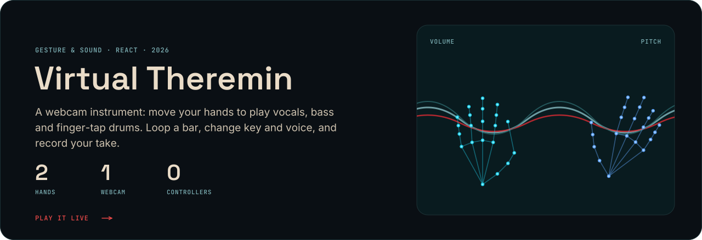
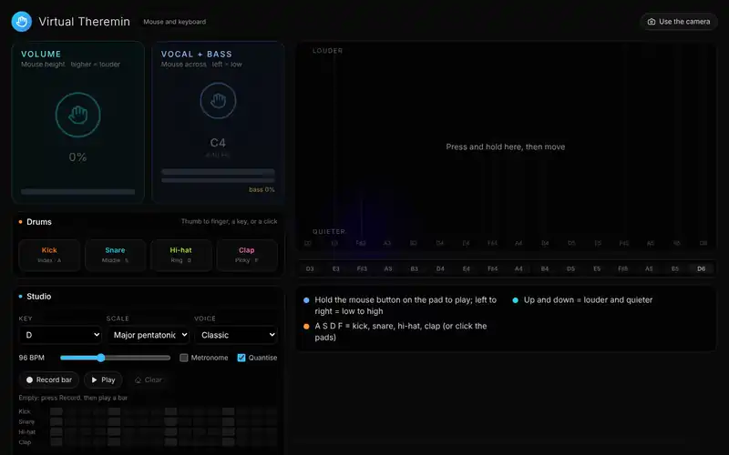
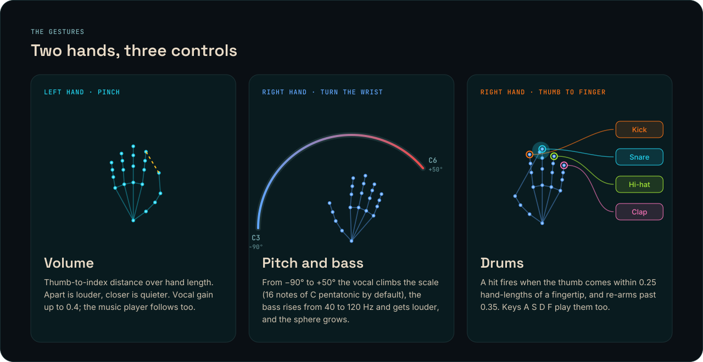
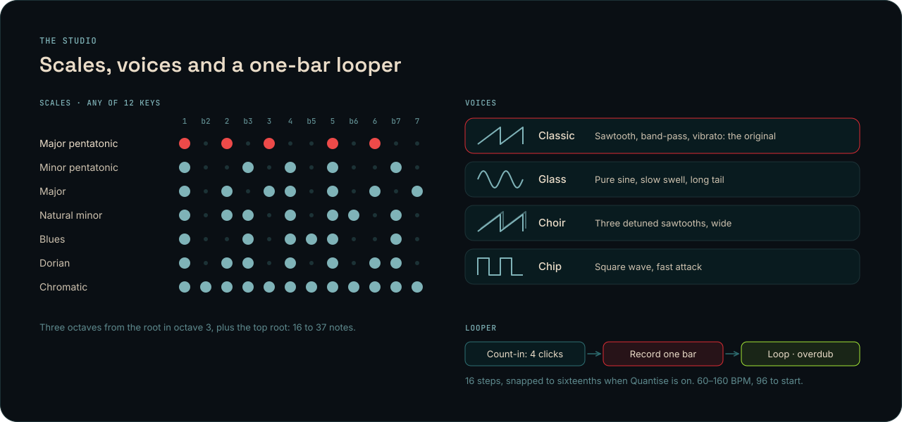
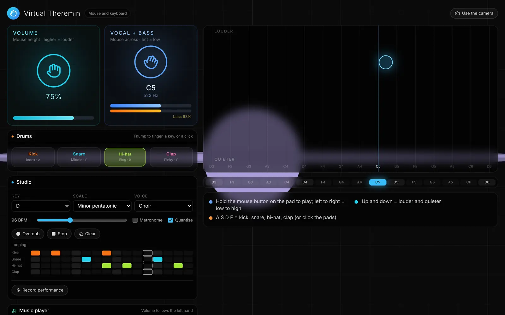
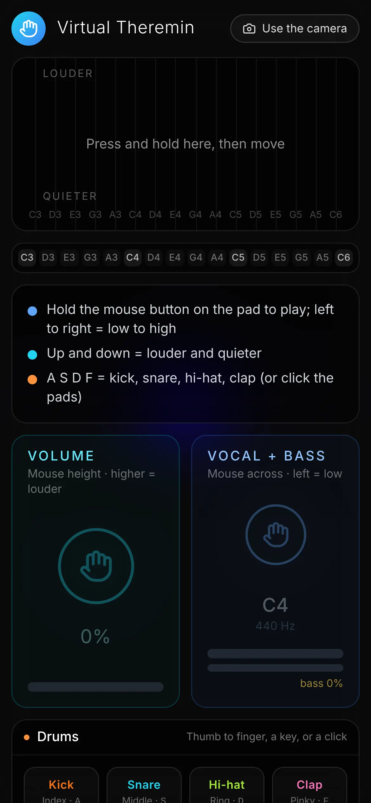
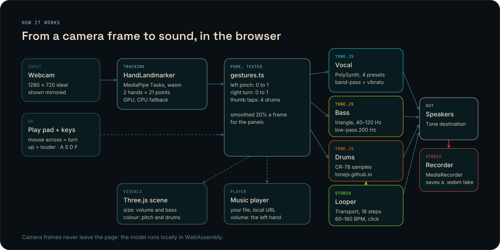

<p align="center">
  <a href="https://virtual-theremin.rayhanson.tech/"></a>
</p>

<p align="center">
  <a href="https://virtual-theremin.rayhanson.tech/"></a>
  <a href="https://github.com/Rayhanson-Git/Virtual-Theremin/actions/workflows/ci.yml"></a>
  
  
  
  
  
  
</p>

<p align="center">
  <a href="#about">About</a> ·
  <a href="#gestures">Gestures</a> ·
  <a href="#the-studio">Studio</a> ·
  <a href="#the-sound">Sound</a> ·
  <a href="#how-it-works">How it works</a> ·
  <a href="#privacy-and-network">Privacy</a> ·
  <a href="#run-it-locally">Run it locally</a> ·
  <a href="#status-and-limits">Limits</a> ·
  <a href="#changelog">Changelog</a>
</p>

## About

A theremin is played without touching it: one hand sets the volume, the other the pitch. Virtual Theremin does the
same with a webcam. Your **left hand** pinches to set the volume, your **right hand** turns at the wrist to move a
synthesised voice up a musical scale while a bass line rises under it, and tapping your **right thumb** to each
finger plays kick, snare, hi-hat and clap. A 3D scene behind the interface swells with the sound and flashes with
every drum.

Around the instrument there is a small studio: pick the key, the scale and the voice, loop a bar of drums at the tempo
you choose, and record the whole performance to a file you can download. No camera, or no light? It also plays with a
mouse and keyboard.

Everything runs in the browser. Hand tracking is MediaPipe's Hand Landmarker in WebAssembly, the sound is Tone.js, and
the camera image never leaves the page.

<p align="center">
  
</p>

<p align="center"><sub>Recorded from the built app in a headless browser, in mouse-and-keyboard mode: D minor pentatonic, a bar of drums looped from the keyboard, then the play pad.</sub></p>

## Gestures

<p align="center">
  
</p>

| Hand | Gesture | What it does |
|---|---|---|
| **Left** | Pinch thumb and index | **Volume.** The gap between them, measured against the size of your hand: apart is louder, closer is quieter. It also sets the volume of the music player. |
| **Right** | Turn the wrist | **Pitch and bass.** Across a 140° turn, from 90° one way to 50° the other way of upright, the vocal climbs every note of the scale, the bass rises from 40 to 120 Hz and gets louder, and the sphere grows. |
| **Right** | Thumb to index | **Kick** |
| **Right** | Thumb to middle | **Snare** |
| **Right** | Thumb to ring | **Hi-hat** |
| **Right** | Thumb to pinky | **Clap** |

A tap fires when the thumb comes within 0.25 hand-lengths of a fingertip and re-arms only once they are more than
0.35 apart again, so one touch is one hit even when the tracking jitters. Taking a hand out of view silences what it
controls.

**Without a camera,** choose **Play with mouse and keyboard**. Hold the mouse button (or a finger) on the play pad:
left to right is the wrist turn, bottom to top is the pinch. <kbd>A</kbd> <kbd>S</kbd> <kbd>D</kbd> <kbd>F</kbd> play
kick, snare, hi-hat and clap in either mode, and the drum pads can be clicked. You can switch to the camera at any time.

## The studio

<p align="center">
  
</p>

| Control | What it does |
|---|---|
| **Key** | Any of the 12 notes, C to B. The range always runs from the key's note in octave 3 to the same note in octave 6. |
| **Scale** | Major pentatonic (the original, and the default), minor pentatonic, major, natural minor, blues, Dorian or chromatic: 16 to 37 notes across the wrist's turn. |
| **Voice** | **Classic**, the original sawtooth through a band-pass and vibrato; **Glass**, a pure sine with a slow swell, closest to a real theremin; **Choir**, three detuned sawtooths; **Chip**, a square wave with a fast attack. |
| **Note ladder** | Every note in reach, low to high, with the one playing lit and each octave's root marked. |
| **Tempo** | 60 to 160 BPM, 96 to start. **Metronome** clicks every beat, with a higher click on the first. |
| **Record bar** | One bar of count-in clicks, then the next bar of drums you play (by hand, key or click) is recorded and loops. Press **Overdub** to add another pass; **Stop**, **Play** and **Clear** do what they say. |
| **Quantise** | On by default: recorded hits snap to the nearest sixteenth. Off keeps them exactly where you played them. Live hits are never delayed. |
| **Record performance** | Records everything the instrument plays, loop and metronome included, and offers the take to play back and download as `virtual-theremin-<date>-<time>.webm`. |
| **Music player** | Plays an audio file of yours under the instrument, with its volume on your left hand. |

<table>
  <tr>
    <td width="62%"></td>
    <td width="38%"></td>
  </tr>
  <tr>
    <td align="center"><sub><b>Mouse and keyboard mode, mid-loop.</b> D minor pentatonic in the Choir voice.</sub></td>
    <td align="center"><sub><b>On a phone,</b> everything stacks.</sub></td>
  </tr>
</table>

## The sound

| Voice | How it is made | Follows |
|---|---|---|
| **Vocal** | A Tone.js `PolySynth` in the chosen voice, through a band-pass filter (Q 1.5) and a 5 Hz vibrato. Notes snap to the scale. | Pitch: the wrist turn. Filter: 800 to 2,800 Hz with the turn. Level: up to 0.4 with the pinch. |
| **Bass** | A triangle oscillator through a 24 dB/octave low-pass at 200 Hz. | Pitch: 40 to 120 Hz with the turn. Level: up to 0.35 with the turn. |
| **Drums** | Samples of the Roland CR-78 drum machine from the Tone.js example library. Clap plays the CR-78's third tom. | Finger taps, keys, clicks and the loop. |
| **Click** | A short triangle blip: A5 on the first beat, E5 on the others. | The metronome and the count-in. |

With the default settings the vocal moves through C major pentatonic from C3 to C6: C D E G A in three octaves, and a
top C. No two neighbouring notes clash, so a sweep always sounds like music.

## How it works

<p align="center">
  
</p>

1. **Camera.** `getUserMedia` asks for a 1280 × 720 stream. The preview is mirrored with CSS so it feels like a mirror;
   the frames go to the model as they are.
   **Which hand is which** was checked with real hands: MediaPipe's own photo of two left hands, fed in as an
   unmirrored camera frame, is labelled "Left" by the Hand Landmarker this app pins, and a frame with one real hand of
   each played volume with the left and pitch with the right, as designed.
2. **Tracking.** MediaPipe's Hand Landmarker (float16 model, running mode `VIDEO`, up to 2 hands, confidence 0.5)
   finds 21 points per hand. It runs on the GPU when it can and falls back to the CPU, and only when the camera has a
   new frame.
3. **Gestures.** [`src/services/gestures.ts`](src/services/gestures.ts) is pure maths with no browser APIs: the pinch
   gap and the fingertip gaps divided by the wrist-to-middle-finger length, and the wrist turn as the angle from the
   wrist to the middle knuckle, mapped from −90°…+50° to 0…1. It is covered by unit tests that pin its behaviour.
4. **Sound.** [`src/services/sound.ts`](src/services/sound.ts) maps those values to notes, frequencies and levels,
   and builds the scales. The Tone.js services apply them with short ramps (0.08 to 0.15 s) so nothing clicks.
5. **Rhythm.** [`src/services/rhythm.ts`](src/services/rhythm.ts) runs one callback per sixteenth on Tone's transport:
   the metronome, the count-in, the loop playback and the switch from recording to looping all hang off it.
   The timing maths is in [`pattern.ts`](src/services/pattern.ts), with tests.
6. **Interface.** The values change every camera frame, so they live in a ref, not in React state. The hand overlay
   and the 3D scene read them in their own animation loops; React redraws the panels at most 20 times a second.

## Privacy and network

The camera image is processed in the page and never sent anywhere. There are no accounts, analytics or cookies.

| What | Where from | When |
|---|---|---|
| The app itself | `virtual-theremin.rayhanson.tech` | When you open it. |
| MediaPipe's WebAssembly runtime | jsDelivr (`cdn.jsdelivr.net`), pinned to the same release as the JavaScript API (0.10.22-rc.20250304) | When you start with the camera. |
| The hand-tracking model (about 7.8 MB) | Google (`storage.googleapis.com`) | When you start with the camera. |
| Four drum samples | The Tone.js site (`tonejs.github.io`) | When you press start, in either mode. If they cannot load, the drum panel says so and the rest still plays. |
| Your audio file | Nowhere: it plays from a local object URL | When you choose one. |
| Your recorded take | Nowhere: it stays in the page until you download it | When you stop recording. |

## Run it locally

You need Node.js 20 or later.

```bash
git clone https://github.com/Rayhanson-Git/Virtual-Theremin.git
cd Virtual-Theremin
npm install
npm run dev
```

Open the address Vite prints (it ends in `/Virtual-Theremin/`). Browsers only allow the camera on `localhost` or over
HTTPS. Other scripts:

| Command | What it does |
|---|---|
| `npm test` | The unit tests for the gesture maths, the scales and sound mappings, the looper timing, and the MediaPipe version pin. |
| `npm run typecheck` | TypeScript, for the app and for the Vite config. |
| `npm run lint` | ESLint, with the React hooks rules. |
| `npm run build` | The production build in `dist/`, with Three.js, Tone.js, MediaPipe and React in their own files. |

CI runs all four on every push. Pushes to `main` also deploy `dist/` with
[`.github/workflows/deploy.yml`](.github/workflows/deploy.yml).

## Project layout

```text
src/
  components/
    VirtualTheremin.tsx   the app: start screen, inputs, panels, layout
    HandOverlay.tsx       hand skeletons over the camera preview
    ThreeVisualization.tsx  the sphere and rings behind everything, blurred into an ambient glow
    PlayPad.tsx           the mouse and touch pad
    NoteLadder.tsx        every note in reach, the current one lit
    DrumPad.tsx           the four drum pads
    StudioPanel.tsx       key, scale, voice, tempo, looper, recorder
    MusicPlayer.tsx       your own audio file under the instrument
  services/
    gestures.ts           pure gesture maths (+ gestures.test.ts)
    sound.ts              scales, voices and sound mappings (+ sound.test.ts)
    pattern.ts            looper timing (+ pattern.test.ts)
    handTracking.ts       MediaPipe Hand Landmarker
    audioSynthesis.ts     the vocal and bass voices
    drumSynthesis.ts      the drum samples
    rhythm.ts             tempo, metronome and the looper
    performanceRecorder.ts  recording the output to a file
    liveState.ts          the per-frame values shared by the loops
  test/hands.ts           synthetic 21-point hands for the tests
public/favicon.svg        the tab icon
assets/                   README images, the demo recording and the social preview
design/                   the script that draws the SVGs in assets/
```

The SVG illustrations are drawn by [`design/artwork.mjs`](design/artwork.mjs) in the Rayhanson palette, with every
word turned into outlines. The hand skeletons in them are the same synthetic hands the tests use. The screenshots and
the recording come from the built app, driven in a headless browser with a fake camera.

## Status and limits

- **A desktop or laptop is best.** The camera mode wants both hands well lit and in frame; on a phone, mouse-and-touch
  mode works but the camera view is small.
- **The drum samples come from a site this project does not control.** If `tonejs.github.io` is unreachable the drum
  pads, keys and loop stay silent, and the drum panel says so.
- **The loaded song is not in the recording.** It plays through its own audio element, outside Tone.js. Recordings are
  WebM in Chrome and Edge, Ogg in Firefox, and MP4 in Safari, whichever the browser records natively.
- **The looper is one bar of 4/4,** 16 steps. Changing the tempo mid-loop takes effect at once.

## Changelog

**1.1.0, November 2026.** New features, and a rebuild of the interface around them. The gestures, the original scale,
the thresholds and the original voice are unchanged.

New:

- **Keys and scales:** 12 keys and 7 scales, with C major pentatonic still the default.
- **Voices:** Classic (the original), Glass, Choir and Chip.
- **A one-bar drum looper** with count-in, overdub and a step grid, a **tempo** control (60 to 160 BPM), a
  **metronome**, and **quantise** for recorded hits.
- **Record your performance** and download the take.
- **Mouse-and-keyboard mode,** so it plays without a camera, and **A S D F** drum keys and clickable pads in both modes.
- **A note ladder** that shows every note in reach and the one playing.
- **Drum-reactive visuals:** every hit kicks the sphere and tints it in the drum's colour.
- Clear error messages for a blocked, missing or busy camera, and a drum panel that reports failed samples.

Fixed and changed:

- The 3D scene is blurred into a soft ambient glow, so where it shows between and through the panels it reads as
  light rather than as a stray shape.
- The layout was built for a 4K screen (a fixed 1200 px camera and 560 px panels). It now fits anything from a phone
  to a 4K display.
- MediaPipe's WebAssembly runtime was loaded from version 0.10.0 while the JavaScript API was 0.10.22. Both now come
  from the same pinned release, and a test checks it.
- The audio context now starts inside the click, so a slow model download can no longer leave the sound switched off.
- Hand tracking runs only on new camera frames, falls back to the CPU when the GPU delegate is unavailable, and the
  interface no longer re-renders React on every frame.
- The 3D scene was painted over by the page background and never showed; it now does, at a smaller size.
- The camera overlay follows the camera's real aspect ratio, so the skeleton lines up on 4:3 cameras too.
- The page title, favicon and social preview were the starter template's; the unused Supabase dependency and the
  template files are gone; TypeScript and ESLint pass cleanly; unit tests and CI are new.

## Credits

Made by Harvey Rayhanson ([rayhanson.tech](https://rayhanson.tech)) with React, Tone.js, MediaPipe and Three.js. The
drum sounds are the Roland CR-78 samples from the [Tone.js](https://tonejs.github.io) examples. No licence has been
chosen for this repository, so all rights are reserved.
